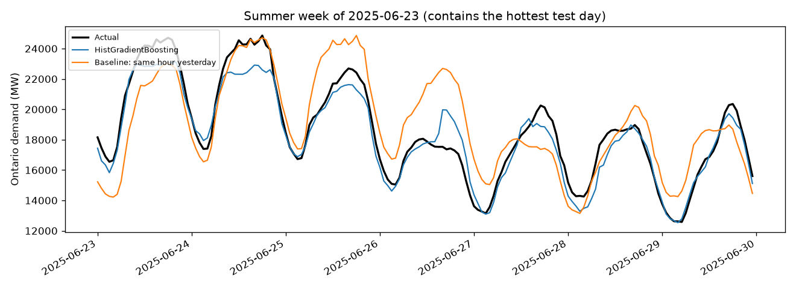
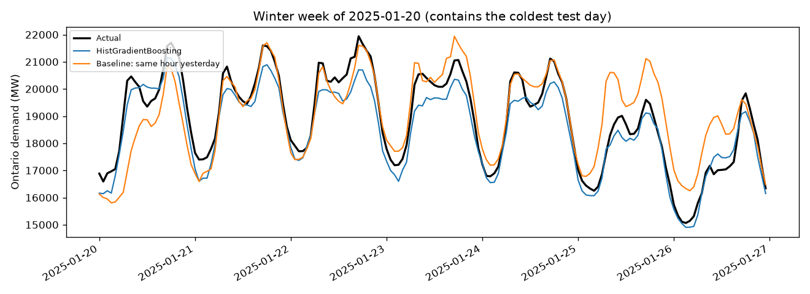
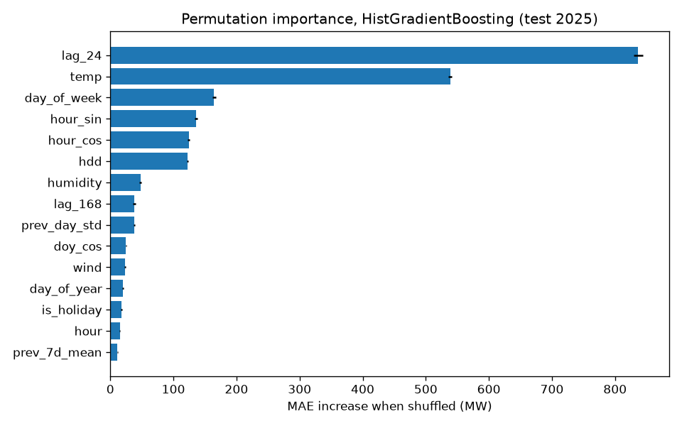

# ontario-demand-forecast

Day-ahead forecasting of Ontario's hourly electricity demand from public IESO data and
Open-Meteo weather. At the end of each day, the models predict all 24 hours of the next day.
Three scikit-learn models (ridge regression, random forest, gradient boosting) are compared
against naive "same hour yesterday / last week" baselines on a held-out test year that was
used exactly once. Every number in this README comes from `results/metrics.json`, written by
`python -m src.evaluate`.

## Problem

The grid operator has to schedule generation before demand arrives. The task here is the
classic day-ahead version: **at the end of day D, forecast Ontario Demand (MW) for each hour
of day D+1.** Any feature must be something that is actually known at that moment.

## Data

| Source | Used for |
|---|---|
| [IESO public demand reports](https://reports-public.ieso.ca/public/Demand/) `PUB_Demand_{year}.csv`, 2018-2025 | Target: `Ontario Demand`, hourly |
| [Open-Meteo Historical Weather API](https://open-meteo.com/en/docs/historical-weather-api) | Hourly temperature, humidity, wind for Toronto, Ottawa, Windsor (simple average) |
| [`holidays`](https://pypi.org/project/holidays/) package | Ontario statutory holidays |

Details, licences and known data issues are in [data/README.md](data/README.md). In short:
IESO hours are Hour Ending 1-24 in Eastern Standard Time all year, so there is no
daylight-saving duplication or gap; rows are labelled by the hour's start in EST, and weather
is requested in UTC and shifted to EST. One hour (2025-05-01 00:00) is missing from the IESO
file; it is forward-filled for building features and excluded from scoring.

## Method

**Features** (`src/features.py`), all computed relative to the issue time, 23:00 on day D:

- Calendar: hour, day of week, month, day of year, weekend, holiday, day before / after a
  holiday, sine/cosine of hour and day of year.
- Demand: `lag_24`, `lag_48`, `lag_168`, and the mean and standard deviation of day D and of
  days D-6..D.
- Weather at the target hour: temperature, humidity, wind, heating degrees `max(18 - T, 0)`
  and cooling degrees `max(T - 18, 0)`. **This uses actual observed weather as a stand-in for
  a day-ahead weather forecast, so results are somewhat optimistic**; a real deployment would
  use forecast weather, which has its own error.

`tests/test_features.py` proves there is no look-ahead: it overwrites every demand value
from the start of D+1 onward with random numbers and checks that the features for D+1 are
bit-for-bit unchanged.

**Split** (`src/split.py`): by calendar year, never shuffled.
Train 2018-2023, validation 2024, test 2025 (the most recent full year).

**Models** (`src/models.py`):

| Model | Notes |
|---|---|
| Same hour yesterday | `lag_24` |
| Same hour last week | `lag_168` |
| Hybrid | `lag_168` on Sat, Sun and Mon (yesterday was a different kind of day), `lag_24` otherwise. Monday is included because "yesterday" for a Monday is a Sunday. |
| Ridge regression | One-hot hour / weekday / month, standardised numeric features; encoder and scaler fit inside the pipeline on training folds only |
| Random forest | 150 trees |
| HistGradientBoostingRegressor | No early stopping (its internal validation split is random, not chronological) |

**Tuning** (`src/train.py`): a small grid per model, scored by MAE with a 3-fold expanding
window `TimeSeriesSplit` on 2018-2023. The tuned models are then compared on 2024, and the
best one on 2024 is the "selected" model. For the final evaluation each model is refit with
its chosen hyperparameters on 2018-2024 and scored once on 2025. Chosen hyperparameters are
stored in `results/metrics.json` under `hyperparameters`.

## Results

<!-- RESULTS:START -->
| Model | MAE (MW) | RMSE (MW) | MAPE (%) | Skill vs best baseline |
|---|---:|---:|---:|---:|
| HistGradientBoosting (selected on validation) | 502 | 641 | 2.94 | +33.8% |
| Random forest | 530 | 684 | 3.08 | +30.0% |
| Ridge regression | 536 | 673 | 3.23 | +29.3% |
| Baseline: same hour yesterday | 758 | 1030 | 4.58 | +0.0% |
| Baseline: hybrid | 926 | 1375 | 5.51 | -22.1% |
| Baseline: same hour last week | 1197 | 1673 | 7.05 | -57.9% |

Test year 2025, 8759 hours. Best baseline on the test year: Baseline: same hour yesterday. Skill = 1 - MAE_model / MAE_best_baseline.
<!-- RESULTS:END -->

All three learned models beat every baseline on the test year. "Same hour yesterday" is a
strong baseline; "same hour last week" and the hybrid are much weaker, because a week-old
value misses a week's change in weather.





More plots: [error by hour](results/figures/error_by_hour.png),
[residual histogram](results/figures/residual_histogram.png).

### Detailed breakdown

<!-- DETAILS:START -->
**Validation vs test.** Models were selected on 2024 and scored once on 2025.

| Model | Validation MAE (2024) | Test MAE (2025) |
|---|---:|---:|
| Baseline: same hour yesterday | 751 | 758 |
| Baseline: same hour last week | 1229 | 1197 |
| Baseline: hybrid | 849 | 926 |
| Ridge regression | 522 | 536 |
| Random forest | 466 | 530 |
| HistGradientBoosting | 435 | 502 |

**By segment** (test MAE, MW):

| | HistGradientBoosting | Random forest | Ridge regression | Baseline: same hour yesterday |
|---|---:|---:|---:|---:|
| Mean bias, whole year (pred - actual) | -391 | -396 | -351 | -6 |
| MAE, weekday | 459 | 508 | 498 | 743 |
| MAE, weekend | 609 | 587 | 631 | 795 |
| MAE, non-holiday | 500 | 531 | 533 | 757 |
| MAE, holiday | 562 | 505 | 643 | 790 |

By hour, HistGradientBoosting is best at hour 4 (402 MW) and worst at hour 12 (609 MW). By month it is best in month 5 (293 MW) and worst in month 7 (754 MW).

**Hardest days.** The 10 hottest test days by daily max temperature (mean 27.6 °C) and the 10 coldest by daily min temperature (mean -12.3 °C):

| | HistGradientBoosting | Random forest | Ridge regression | Baseline: same hour yesterday |
|---|---:|---:|---:|---:|
| Heat-wave days: MAE | 1086 | 1213 | 776 | 1434 |
| Heat-wave days: bias (pred - actual) | -1022 | -1168 | -666 | -1338 |
| Heat-wave days: highest prediction (actual peak 24862) | 23438 | 23301 | 25202 | 24789 |
| Cold-snap days: MAE | 577 | 709 | 467 | 691 |
| Cold-snap days: bias (pred - actual) | -533 | -677 | -431 | -470 |
| Cold-snap days: highest prediction (actual peak 21940) | 21158 | 20755 | 21308 | 21701 |

Worst five days for HistGradientBoosting:

| Date | MAE | Bias | Max temp (°C) |
|---|---:|---:|---:|
| 2025-06-22 | 1922 | -1922 | 31.5 |
| 2025-08-10 | 1542 | -1527 | 32.2 |
| 2025-12-26 | 1433 | -1433 | -5.4 |
| 2025-03-29 | 1403 | -1403 | 6.4 |
| 2025-08-16 | 1364 | -1364 | 30.5 |

**Permutation importance** (HistGradientBoosting, test year, top 10):

| Feature | MAE increase when shuffled (MW) |
|---|---:|
| `lag_24` | 837 ± 7 |
| `temp` | 539 ± 3 |
| `day_of_week` | 164 ± 3 |
| `hour_sin` | 136 ± 3 |
| `hour_cos` | 124 ± 2 |
| `hdd` | 123 ± 1 |
| `humidity` | 48 ± 2 |
| `lag_168` | 38 ± 2 |
| `prev_day_std` | 38 ± 1 |
| `doy_cos` | 25 ± 1 |
<!-- DETAILS:END -->

### Interpretation

- **What the selected model relies on.** Yesterday's demand at the same hour (`lag_24`) and
  temperature dominate; shuffling either one costs far more MAE than any other feature.
  Day of week and the hour encodings come next, which is the daily and weekly shape of demand.
  Raw `temp` and the heating-degree term both matter because demand rises in both directions
  away from mild weather.
- **What goes wrong on hard days: the models under-forecast extremes.** On heat-wave days all
  models have a large negative bias (they predict too low), and the tree models' highest
  predictions stay well below the actual peak. Random forests and gradient boosting predict by
  averaging training targets in a leaf, so they cannot output a value higher than what they saw
  in training. 2025 set new demand records, so the peaks were literally out of range.
  Ridge regression extrapolates linearly in temperature and therefore has the smallest error on
  those days, even though it is the weakest learned model overall. Cold snaps show the same
  pattern, smaller.
- **Year-over-year growth.** Demand in 2025 was higher on average than any training year, and
  the selected model's errors lean negative across the whole test year, not only on hot days.
  Features that are levels (lags, rolling means) partly track growth, but the model still
  pulls toward the training distribution. A fix to try next, tuned on validation only, would be
  to predict the change from `lag_24` (or the ratio) instead of the level, or to blend in ridge.
  This was not done here because changing the model after seeing the test year would make the
  test number optimistic.
- **Weekends** are harder than weekdays for every learned model. **Holidays** are harder for
  gradient boosting and ridge but not for the random forest; with only about nine holidays in
  the test year, those holiday numbers are noisy. Boxing Day 2025 is one of the selected
  model's worst days: it is flagged as a holiday, so the model expected low demand, but it was
  also a cold day and actual demand was high.
- The baseline "same hour yesterday" has almost no average bias, because it tracks the level
  of demand automatically. The learned models are more accurate hour by hour but lean low.

## Limitations

- **Actual weather instead of forecast weather.** The biggest caveat; real day-ahead errors
  would be higher, especially on hot days where a 2 °C forecast miss moves demand a lot.
- One province-wide series. No outage, price, embedded-generation, or industrial-load data.
- Weather is an unweighted mean of three cities, not a population- or load-weighted index.
- Tree models cannot predict values outside the range they were trained on, which matters
  when the test year sets new demand records (2025 did).
- 2020 (COVID lockdowns) is in the training data unchanged.
- Hyperparameter search was intentionally small.

## Reproduce

```bash
python -m venv .venv && source .venv/bin/activate
pip install -r requirements.txt
python -m src.data        # download + cache IESO and weather into data/raw/
python -m src.train       # tune on 2018-2023 with TimeSeriesSplit, compare on 2024
python -m src.evaluate    # refit on 2018-2024, score 2025 once, write results/
pytest -q
streamlit run app.py
```

Or `make all test app`.

## Dashboard and deployment

`app.py` is a Streamlit app that loads `results/metrics.json` and `results/predictions.parquet`
and never retrains. To publish it for free on Streamlit Community Cloud:

1. Push this repo to GitHub (the `results/` folder must be committed; `data/raw/` is ignored).
2. On [share.streamlit.io](https://share.streamlit.io), choose "Create app", pick the repo and
   branch, and set the main file to `app.py`.
3. Streamlit installs `requirements.txt` and gives the app a public `*.streamlit.app` URL.

## Repo layout

```
src/data.py       download, cache and join IESO + weather
src/features.py   leakage-safe features
src/split.py      chronological split, TimeSeriesSplit
src/models.py     baselines and model definitions
src/train.py      tuning on train, comparison on validation
src/evaluate.py   single test-year evaluation, figures, metrics.json
app.py            Streamlit dashboard
tests/            pytest: leakage, split ordering, lags, holidays
```
